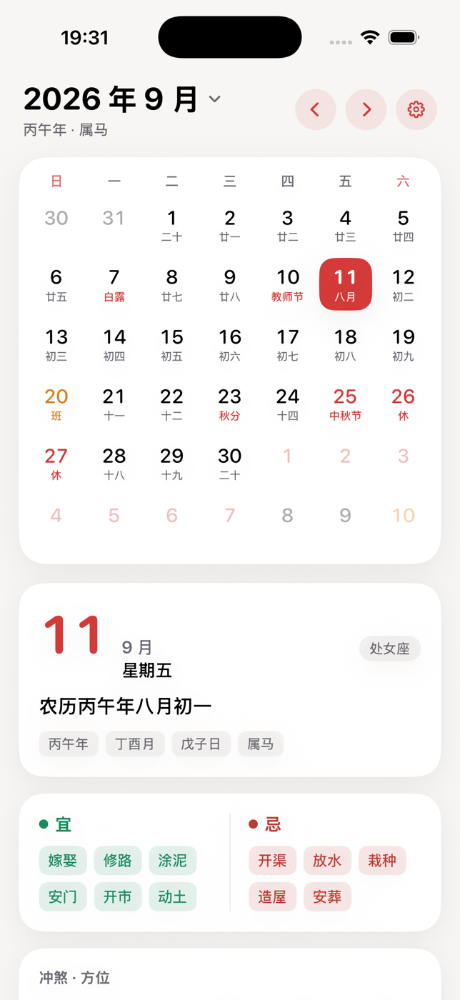
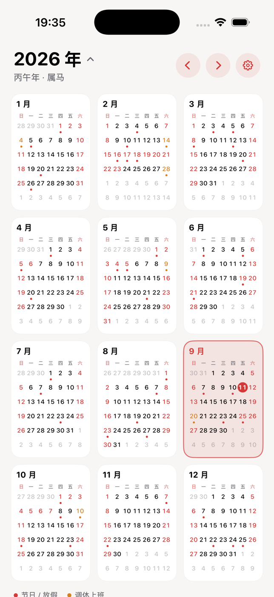
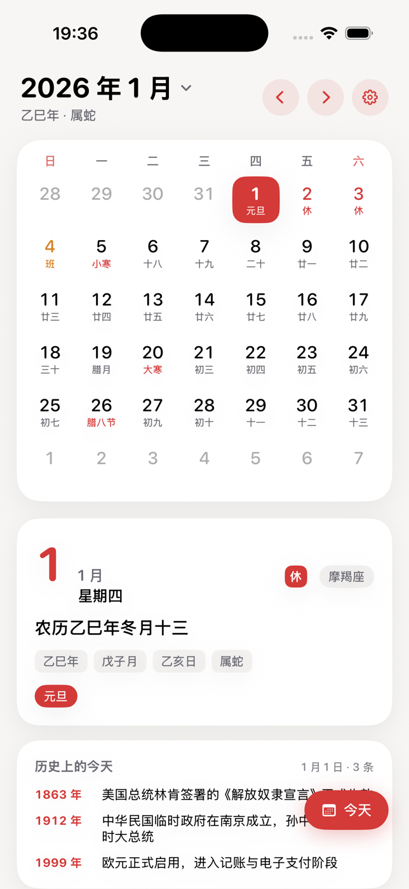
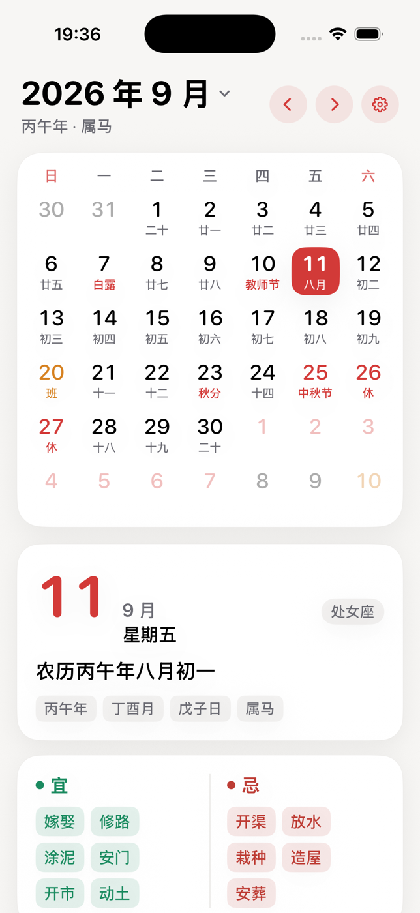
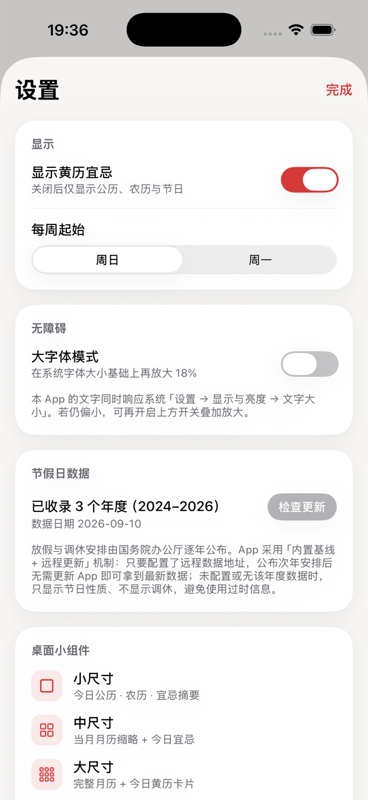
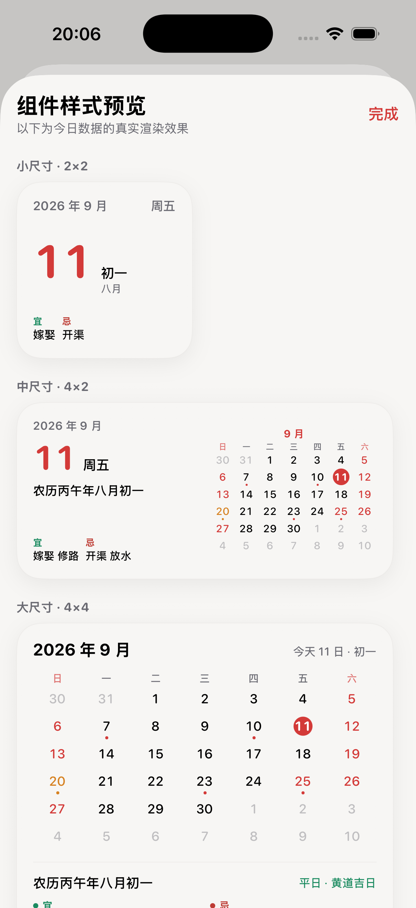

# 简日历（iPhone / iOS 17+）

一款纯净、极简、无广告的 iPhone 日历。之前下载的「纯净版日历」后来也变成了广告满天飞，于是自己做了一个真正干净、专注的。

## 它能做什么

- **打开即今天**：启动自动定位当天，右下角「今天」悬浮按钮随时一键回到当天。
- **公历 + 农历 + 节日**：月历网格，公历大数字、农历/节日小字；今天高亮、节假日标红；左右滑动翻月。
- **黄历一屏看全**：农历全称、干支、生肖、星座、宜/忌、冲煞、吉神方位、值日、彭祖百忌。
- **放假调休一眼可见**：「休」用主色红、「调休上班」用琥珀橙，最容易被漏看的「周末却要上班」也一眼分清。
- **年视图**：点顶部月份标题展开，一屏纵览 12 个月，点任意月跳转。
- **历史上的今天**：精选 80+ 个日期、100+ 条有公开记载的史实。
- **多尺寸桌面 + 锁屏小组件**：小 / 中 / 大三档，加锁屏矩形、行内两种。
- **大字体模式 + 无障碍**：字号随系统动态字体缩放，支持 VoiceOver，配色对比度满足 WCAG 2.1 AA。
- **深色模式**：全站自适应浅色 / 深色。
- **节假日自动更新**：国务院公布次年安排后，无需更新 App 即可同步（详见文末「远程更新接口」）。

| 月视图与黄历 | 年视图 | 历史上的今天 | 大字体模式 | 设置 | 小组件预览 |
| ------ | --- | ------ | ----- | -- | ----- |
|  |  |  |  |  |  |

> 技术栈：SwiftUI + WidgetKit，纯原生，无第三方依赖。

---

## 运行

**命令行（最快）**

```bash
cd "日历 APP"

# 构建（模拟器）
xcodebuild -project CalendarApp.xcodeproj -scheme CalendarApp \
  -sdk iphonesimulator -destination 'platform=iOS Simulator,name=iPhone 17' \
  -configuration Debug -derivedDataPath build/DerivedData \
  CODE_SIGNING_ALLOWED=NO build

# 启动模拟器 → 安装 → 运行
xcrun simctl boot "iPhone 17"
xcrun simctl install booted build/DerivedData/Build/Products/Debug-iphonesimulator/CalendarApp.app
xcrun simctl launch booted com.ixiaoqiang.calendarapp
```

**Xcode 打开**：双击 `CalendarApp.xcodeproj`，选 CalendarApp target → Signing & Capabilities 勾选 *Automatically manage signing*，选自己的 Apple ID，再选任意 iPhone 模拟器运行。小组件在主屏长按空白 → 左上角「+」→ 搜索「日历」添加。

> 若报 CalendarWidget 签名错误，在 CalendarWidget target 里同样选一次 Team。

---

## 数据与算法

- **农历 / 节气**：1900–2100 查表算法，数据由脚本从开源库 `solarlunar`（MIT）生成，已核对春节、中秋、端午、清明及各节气。
- **干支口径**：年柱与生肖按「农历年（正月初一换年）」；月柱按二十四「节」划分。
- **黄历宜忌**：传统建除十二神体系，集中在 `Almanac.swift`，可无缝替换商业数据源。
- **历史上的今天**：只收录有公开可查证记载的史实；某日无收录则不显示卡片。
- **无障碍**：全站字号用 `scaledFont`，桌面小组件只跟随系统动态字体（倍率上限 1.3）。

### 节假日自动更新

放假与调休由国务院逐年公布，写死在代码里就得每年重新发版。本 App 用三级数据源，后者覆盖前者：

1. **内置基线**（随包发布，保证首次启动与离线可用）
2. **本地缓存**（App Group 共享容器，主 App 与小组件都能读）
3. **远程数据**（`HolidayPlansURL` 指向的同结构 JSON，公布后无需发版即可更新）

缺数据时优雅降级为「只标节日性质、不显示调休」，绝不猜测、绝不用过时数据。远程接口规范见文末第七节。

---

## 目录结构

```
日历 APP/
├── project.yml                      # XcodeGen 工程定义
├── CalendarApp.xcodeproj            # 已生成的 Xcode 工程
├── docs/screenshots/                # 界面实拍
├── Sources/
│   ├── Shared/                      # App 与小组件共享
│   │   ├── Lunar/                   # 农历、节气、黄历、节日、放假调休、历史上的今天
│   │   ├── Models/                  # SolarDate / DayInfo / MonthGrid / CalendarYear
│   │   ├── Views/                   # MiniMonthGrid + 小组件视图（主 App 预览复用）
│   │   ├── Resources/               # holiday-plans.json（内置节假日基线）
│   │   └── DesignSystem/            # 配色、卡片、字号缩放
│   ├── App/                         # 主 App：入口 + 视图 + 诊断工具
│   │   ├── CalendarApp.entitlements # App Group 声明
│   │   └── Views/                   # RootView / MonthGrid / DayDetail / Year / History / Settings / WidgetPreview
│   └── Widget/                      # WidgetKit 扩展
│       └── CalendarWidget.entitlements
└── Tests/UITests/                   # XCUITest：滚动性能 + 点击回归
```

> 小组件视图实现放在 `Sources/Shared/Views/WidgetViews.swift`，主 App 的「组件样式预览」直接复用，保证预览与真机一致。

---

## 重新生成工程

改了文件结构或 `project.yml` 后：

```bash
export USER=$(id -un) LOGNAME=$USER
xcodegen generate --spec project.yml
```

---

## 七、节假日远程更新接口规范（服务端开发用）

> 客户端已按本规范实现完毕，地址预置在 `Info.plist` 的 `HolidayPlansURL`（`https://blog.zhaojq.top/calendar/holiday-plans.json`，当前接口尚未开发，请求返回 404，界面给友好提示）。服务端按此发布 JSON 后，用户端「检查更新」立即可用，客户端无需改动、无需发版。

### 请求

| 项 | 值 |
| --- | --- |
| 方法 | `GET` |
| 地址 | `https://blog.zhaojq.top/calendar/holiday-plans.json` |
| 入参 | 无（不需 query、请求体、鉴权） |
| 期望响应 | `200 OK` + `Content-Type: application/json; charset=utf-8` |

客户端不做缓存协商，每次「检查更新」都是整包 GET。建议 CDN TTL 设短（如 5 分钟）。

### 响应体结构

```json
{
  "schemaVersion": 1,
  "updatedAt": "2026-11-12T09:00:00+08:00",
  "plans": [
    {
      "year": 2027,
      "source": "国办发明电〔2026〕X号",
      "publishedAt": "2026-11-12",
      "days": {
        "1-1": "holiday",
        "2-5": "holiday",
        "2-11": "workday"
      }
    }
  ]
}
```

### 字段定义

| 字段 | 类型 | 必填 | 说明 |
| --- | --- | --- | --- |
| `schemaVersion` | Int | 是 | 固定 `1`；大于 1 会被客户端拒绝加载 |
| `updatedAt` | String | 是 | ISO 8601，客户端按字符串字典序比较，**格式与时区偏移必须始终一致**（如统一 `+08:00`） |
| `plans` | Array | 是 | 年度安排列表，可只含新增/变更年份，客户端会与内置基线合并 |
| `plans[].year` | Int | 是 | 年份 |
| `plans[].source` | String | 是 | 数据来源（公文标题/发文字号），仅溯源展示 |
| `plans[].publishedAt` | String | 是 | 严格 `yyyy-MM-dd`，同年取较晚者 |
| `plans[].days` | Object | 是 | 逐日安排，见下 |

### `days` 的写法（最容易出错）

**键**：`"月-日"`，月与日**都不带前导零**。

| ✅ 正确 | ❌ 错误 |
| --- | --- |
| `"1-1"`、`"2-15"`、`"10-1"` | `"01-01"`、`"02-15"`、`"10-01"` |

格式不对会静默查不到（该日无标记且不报错）。

**值**：只有两种。

| 值 | 含义 | 界面 |
| --- | --- | --- |
| `"holiday"` | 放假 | 角标「休」（主色红） |
| `"workday"` | 调休上班 | 角标「班」（琥珀橙） |

**普通周末不要写进 `days`**：周末是否休息由日历规则推断，只有国务院特别点名的日期才写。

### 客户端容错

| 服务端返回 | 客户端行为 |
| --- | --- |
| `200` + 合法 JSON，比本地新 | 写入共享容器 → 提示「已更新：XXXX 年」→ 刷新小组件 |
| `200` + 不比本地新 | 提示「已是最新数据」 |
| `404` / 其他非 2xx | 友好提示，继续用内置数据，**不弹错、不覆盖** |
| JSON 解析失败 / `schemaVersion > 1` | 视为「暂时拿不到」，退回既有数据 |
| 某年完全无数据 | 该年只标节日性质，不显示调休 |

> 一句话原则：远程更新是锦上添花，拿不到新数据时 App 仍正确可用。
