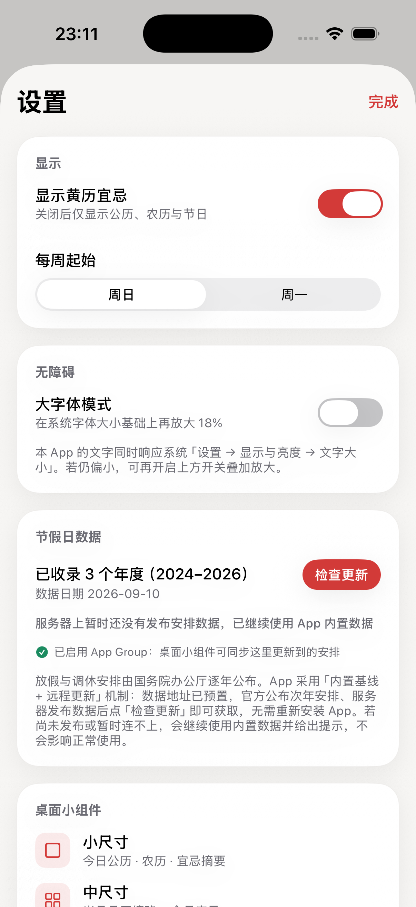
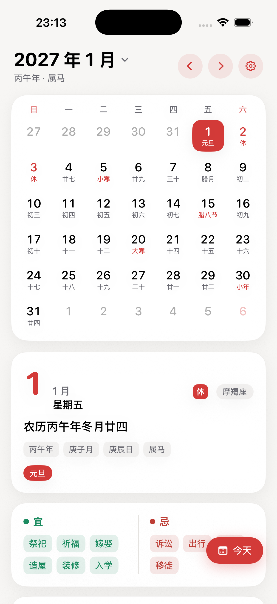
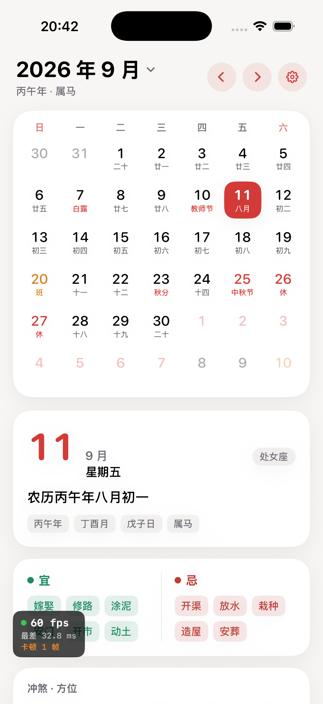
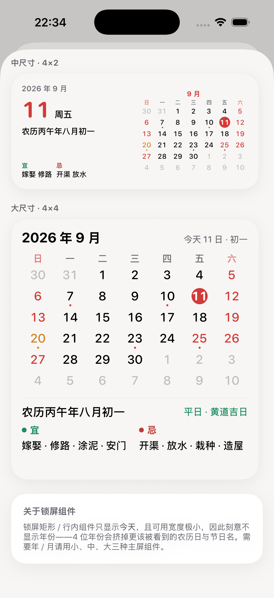
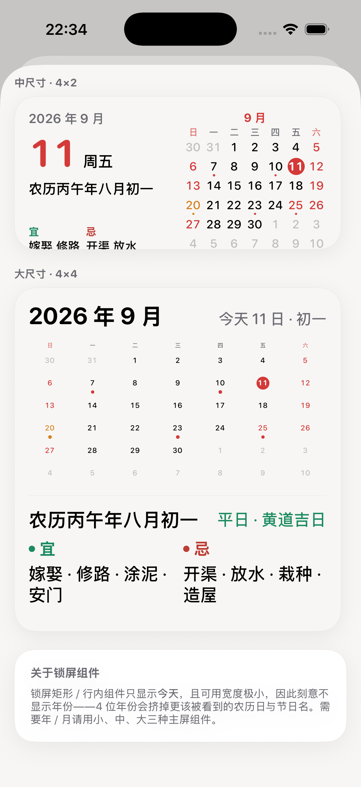

# 日历 App（iPhone / iOS 17+）

之前下载的纯净版日历，现在也是广告满天飞，就自己做了一个纯净、极简、功能专注日历的“日历 app”

一款现代化、视觉舒适的 iPhone 日历 App：公历 + 农历 + 节日节气 + 老黄历（宜忌/冲煞/吉神）+ 放假调休 + 历史上的今天，并提供多尺寸桌面与锁屏小组件。

技术栈：**SwiftUI + WidgetKit**，纯原生，无第三方依赖。

| 月视图与黄历 | 年视图 | 历史上的今天 | 大字体模式 | 设置 | 小组件预览 |
| ------ | --- | ------ | ----- | -- | ----- |
|  |  |  |  |  |  |

---

## 一、环境与验证状态

本机已安装 **Xcode 26.6**（iPhoneOS 26.5 SDK + iPhone 17 模拟器）。当前状态：

| 项目                                                 | 状态                                |
| -------------------------------------------------- | --------------------------------- |
| 真机 SDK 构建（`iphonesimulator`，arm64，iOS 17.0 target） | ✅ 通过，**0 错误 0 警告**                |
| 模拟器安装 / 启动 / 渲染                                    | ✅ 已实测（上方 5 张截图均为 iPhone 17 模拟器实拍） |
| `CalendarApp` + `CalendarWidget` 双 target          | ✅ 均编译链接成功，widget 已嵌入 `PlugIns/`   |
| `holiday-plans.json` 打包进 App Bundle                | ✅ 已验证（3150 B，见构建产物）               |

> 若要自己跑一遍：见第二节。

---

## 二、运行步骤

### 方式 A：命令行构建 + 模拟器（最快）

```bash
cd "日历 APP"

# 构建（模拟器）
xcodebuild -project CalendarApp.xcodeproj -scheme CalendarApp \
  -sdk iphonesimulator -destination 'platform=iOS Simulator,name=iPhone 17' \
  -configuration Debug -derivedDataPath build/DerivedData \
  CODE_SIGNING_ALLOWED=NO build

# 启动模拟器 → 安装 → 运行
xcrun simctl boot "iPhone 17"
xcrun simctl install booted build/DerivedData/Build/Products/Debug-iphonesimulator/CalendarApp.app
xcrun simctl launch booted com.ixiaoqiang.calendarapp
```

### 方式 B：Xcode 打开

1. 双击 `CalendarApp.xcodeproj`。
2. 选择 **CalendarApp** target → Signing & Capabilities → 勾选 *Automatically manage signing*，Team 选自己的 Apple ID。
3. 选择任意 iPhone 模拟器 → ▶️ 运行。
4. 添加小组件：主屏长按空白 → 左上角「+」→ 搜索「日历」→ 选择尺寸。

> 若报 "CalendarWidget" 签名错误，在 CalendarWidget target 里同样选一次 Team。

### 调试用启动参数（仅 Debug 构建生效）

便于自动化截图 / 冒烟测试：

```bash
xcrun simctl launch booted com.ixiaoqiang.calendarapp -startMode year        # 直接进年视图
xcrun simctl launch booted com.ixiaoqiang.calendarapp -startDate 2026-10-01  # 直接定位到某天
xcrun simctl launch booted com.ixiaoqiang.calendarapp -showSettings          # 直接打开设置页
xcrun simctl launch booted com.ixiaoqiang.calendarapp -showWidgetPreview     # 直接打开「组件样式预览」
xcrun simctl launch booted com.ixiaoqiang.calendarapp -largeFontMode YES     # 开启大字体（走 UserDefaults）
xcrun simctl launch booted com.ixiaoqiang.calendarapp -showFPSHud YES        # 首页显示实时帧率 HUD
xcrun simctl launch booted com.ixiaoqiang.calendarapp -scrollProbe           # 自动滚动 10 秒并打印帧统计
xcrun simctl launch booted com.ixiaoqiang.calendarapp -scrollProbeStatic     # 只统计不自动滚动（手动滑时采样）
```

组件与节假日更新相关的补充参数：

```bash
xcrun simctl launch booted com.ixiaoqiang.calendarapp -showWidgetPreview -widgetPreviewFocusLarge   # 预览页直接滚到大尺寸组件
xcrun simctl launch booted com.ixiaoqiang.calendarapp -showWidgetPreview -widgetTextScale 1.3       # 按 1.3 倍率压测组件是否溢出
xcrun simctl launch booted com.ixiaoqiang.calendarapp -showSettings -autoCheckHolidayUpdate         # 进设置页后自动点一次「检查更新」
```

> `-autoCheckHolidayUpdate` 用于核对「数据未发布 / 网络不可用」时的友好提示 —— 模拟器无法脚本化点击，靠它才能截到那张图。

### 跑测试（滚动性能 + 交互回归）

```bash
xcodebuild test -project CalendarApp.xcodeproj -scheme CalendarApp \
  -destination 'platform=iOS Simulator,name=iPhone 17' \
  CODE_SIGNING_ALLOWED=NO
```

- `testHomeScrollHitchRatio`：用**真实触摸**滑动首页，输出 CPU 与滚动时长指标
- `testTappingDayUpdatesDetail`：点击日期格子后详情卡片必须切换（守住 `Button → onTapGesture` 的等价性）

> 为什么滚动性能一定要用 UI 测试：程序化滚动（`ScrollViewReader.scrollTo`）不经过手势系统，测不出「自定义手势与 ScrollView 抢手势」这类问题。

---

## 三、功能一览

### 3.1 原始 4 点需求（P0 / V1）

| 需求                | 实现                                                              |
| ----------------- | --------------------------------------------------------------- |
| 1. 打开自动定位当天       | 启动即定位今天；任意页面右下角「今天」悬浮按钮一键回到当天                                   |
| 2. 公历+农历+节日，默认一个月 | 月历网格：公历大数字 + 农历/节日小字；今天高亮、节假日标红；左右滑动翻月                          |
| 3. 下方展示黄历、宜、忌     | 常驻详情面板：农历全称/干支/生肖/星座、**宜/忌**、冲煞/喜神/财神/福神、值日（建除十二神+天神+黄道黑道）、彭祖百忌 |
| 4. 多尺寸桌面小组件       | 小(2×2) / 中(4×4) / 大(4×8) 三档 + 锁屏矩形、锁屏行内                         |

### 3.2 P1（V1.1）本次新增

| 功能            | 说明                                                                                              |
| ------------- | ----------------------------------------------------------------------------------------------- |
| **年视图**       | 点顶部月份标题（或上滑手势）展开，一屏纵览 12 个月；点任意月份跳转。当前月与今天有高亮，底部有「节日·放假 / 调休上班」图例                               |
| **放假调休标记**    | 月历与年视图直接标出「休 / 班」：放假日用主色，**调休上班日（周末却要上班）用琥珀橙**——最容易被漏看的「班」一眼可见                                  |
| **历史上的今天**    | 精选 80+ 个日期、100+ 条有公开记载的史实，按年份列在详情面板；无收录的日期不显示该卡片                                                |
| **大字体模式**     | 设置页开关，在系统动态字体基础上再放大 18%；配合 `@ScaledMetric` 让全站文字都响应系统字体大小                                       |
| **无障碍打磨**     | 日期格子、宜忌、方位等补齐 VoiceOver 朗读文案；翻月/回今天加入触觉反馈；图标按钮与标签补 accessibility label/hint；配色对比度满足 WCAG 2.1 AA |
| **节假日年度更新机制** | 「内置基线 + 本地缓存 + 远程更新」三级数据源，国务院公布次年安排后**无需重新发版**即可更新（详见第五节）                                       |
| **锁屏组件**      | 矩形 / 行内两种锁屏配件（V1 已实现，本次补进设置页说明）                                                                 |
| **深色主题**      | 全站自适应浅色 / 深色（V1 已实现）                                                                            |

### 3.3 本次修复与优化（V1.2）

| 项               | 说明                                                                                                                                             |
| --------------- | ---------------------------------------------------------------------------------------------------------------------------------------------- |
| **小组件显示年 + 月**  | 小 / 中 / 大三档桌面组件均在顶部显示「YYYY 年 M 月」（如 `2026 年 9 月`）；中尺寸右侧迷你月历额外标出当月月份。锁屏矩形 / 行内组件**刻意不显示年份**（宽度极小，4 位年份会挤掉农历日与节日名）                               |
| **组件样式预览**      | 设置页新增「预览组件样式」，在 App 内按**真机点值尺寸**渲染三档组件，免去「先加到主屏才能看效果」的来回折腾                                                                                     |
| **中尺寸组件溢出修复**   | 迷你月历每格行高固定为「字号 + 7 + 圆点」，6 行约 143pt > 中尺寸可用的 ~126pt，导致月历末行与「宜/忌」被挤出卡片。现为 `MiniMonthGrid` 增加 `cellPadding` / `dotSize` 可调参数，中尺寸改用紧凑参数，内容完整落在卡片内 |
| **性能：滚动卡顿治理**   | 模型层热点优化 + 视图层去重，详见 5.5                                                                                                                         |
| **性能：滚动卡顿二次排查** | 建立「帧探针 + XCUITest 指标」测量手段，结论是滚动已无掉帧；同时修掉 4 个影响交互延迟的真实缺陷，并内置帧率 HUD 供自查。详见 5.6                                                                   |

### 3.4 组件尺寸治理（V1.4）

**背景**：大字体模式下，最大的 4×4 组件沿用与中尺寸相同的字号，内容只占画布上半部分，**看着又小又空**；同时组件字号此前会叠加 App 内「大字体模式」的附加倍率，画布固定不可滚动时容易溢出被裁。

| 项                       | 说明                                                                                                                       |
| ----------------------- | ------------------------------------------------------------------------------------------------------------------------ |
| **大尺寸组件撑满画布**           | `MiniMonthGrid` 新增 `fillHeight`：给定可用高度后**由高度反推字号**，月历自动铺满余下空间。大组件字号同时整体上调（标题 20 / 农历 17 / 宜忌 14·15）                      |
| **组件字号倍率上限 1.3**        | `providesFontScale` 新增 `maxScale`；组件按「系统动态字体 × 1，上限 1.3」缩放。因为 `fillHeight` 会随倍率自动收缩月历让位，**放大到上限也不会溢出被裁**（组件不能滚动，溢出即内容丢失） |
| **组件不再跟随 App 内「大字体模式」** | 桌面组件在 App 之外，理应只跟随**系统**动态字体；App 内的开关不再外溢到主屏。（组件是独立进程，本来就读不到 App 的开关，此前只是「看起来跟着变大」）                                      |
| **预览保真度修复**             | 组件样式预览此前会继承 App 的字号倍率（含「大字体模式」1.18×），看到的比真机更大且会随开关变化。现在每张预览卡单独注入组件自己的缩放规则，与真机一致                                          |
| **预览压测参数**              | 新增 `-widgetPreviewFocusLarge`（直接滚到大尺寸组件）与 `-widgetTextScale <倍率>`（如 `1.3` 压测上限，确认不溢出）                                    |

### 3.5 节假日远程更新落地（V1.5）

| 项                | 说明                                                                                                                              |
| ---------------- | ------------------------------------------------------------------------------------------------------------------------------- |
| **接入 App Group** | 主 App 与小组件共用共享容器，主 App 远程更新后小组件也能读到，**不必重新发版**。两个 target 各配一份 entitlements；未配置时自动回退到 App 私有目录，功能降级而非崩溃。详见 5.2                   |
| **预置接口地址**       | `Info.plist` 的 `HolidayPlansURL` 已填 `https://blog.zhaojq.top/calendar/holiday-plans.json`（**预留**）。接口尚未开发，当前请求会返回 404            |
| **失败不再报错**       | 拿不到数据时只给一句友好提示（如「服务器上暂时还没有发布安排数据，已继续使用 App 内置数据」），**不暴露错误码与技术细节**。技术细节仍保留在 `HolidayStoreError.errorDescription` 供排查。详见 5.2 与第七节 |
| **共享状态可见**       | 设置页显示「已启用 App Group：桌面小组件可同步这里更新到的安排」，方便在真机上自查 capability 是否配好                                                                  |
| **小组件重新读盘**      | 小组件 `getTimeline` 开头调用 `HolidayStore.invalidate()`——`HolidayStore` 有静态缓存且小组件进程常驻，不 invalidate 会出现「文件更新了但组件没变」                   |
| **接口规范入库**       | 完整的请求方式、字段定义、示例与容错规则写入 **README 第七节**，服务端按规范开发即可，客户端无需改动                                                                        |

| App Group 已启用 + 失败友好提示 | 远程数据驱动的休/班标记（2027 年由共享容器提供） |
| ---------------------- | --------------------------- |
|  |  |

---

## 四、目录结构

```
日历 APP/
├── project.yml                      # XcodeGen 工程定义（改文件结构后重新生成工程用）
├── CalendarApp.xcodeproj            # 已生成的 Xcode 工程（直接打开即可）
├── docs/screenshots/                # 界面实拍（iPhone 17 模拟器）
├── Sources/
│   ├── Shared/                      # App 与小组件共享
│   │   ├── Lunar/
│   │   │   ├── LunarData.swift          # 自动生成的农历/节气数据表（1900–2100）
│   │   │   ├── LunarCalendar.swift      # 农历核心：公农历互转、干支、生肖、节气
│   │   │   ├── Almanac.swift            # 黄历：建除十二神、冲煞、彭祖百忌、吉神方位
│   │   │   ├── HolidayProvider.swift    # 节日 / 节气 / 星座
│   │   │   ├── HolidayPlan.swift        # 放假调休数据模型 + 年度更新机制（HolidayStore）
│   │   │   └── HistoryToday.swift       # 历史上的今天数据表
│   │   ├── Models/                  # SolarDate / DayInfo / MonthGrid / CalendarYear
│   │   ├── Views/                   # MiniMonthGrid（主 App 与小组件共用）
│   │   │                            #   WidgetViews（三档 + 锁屏组件视图，主 App 预览也复用）
│   │   ├── Resources/               # holiday-plans.json（内置节假日基线）
│   │   └── DesignSystem/            # 配色、卡片样式、字号缩放（Palette / card / scaledFont）
│   ├── App/                         # 主 App：入口 + 7 个视图 + 诊断工具
│   │   ├── CalendarApp.entitlements # App Group 声明（主 App 侧）
│   │   ├── Diagnostics/             # ScrollDiagnostics（仅 Debug：帧率探针 / 自动滚动 / FPS HUD）
│   │   └── Views/                   # RootView / MonthGridView / DayDetailView /
│   │                                #   YearView / HistoryTodayView / SettingsView /
│   │                                #   WidgetPreviewView（App 内组件样式预览）
│   └── Widget/                      # WidgetKit 扩展：宿主入口 + 时间线
│       └── CalendarWidget.entitlements  # App Group 声明（小组件侧，group 必须与主 App 一致）
├── Tests/UITests/                   # XCUITest：滚动性能指标 + 点击回归
└── README.md
```

> 小组件的**视图实现**（`SmallWidgetView` / `MediumWidgetView` / `LargeWidgetView` / 锁屏组件）放在 `Sources/Shared/Views/WidgetViews.swift`，这样主 App 的「组件样式预览」能直接复用同一份代码，预览与真机表现一致，不会各写一套而走样。

---

## 五、数据与算法说明（重要）

### 5.1 农历 / 节气 / 黄历

- **农历 / 二十四节气**：中文农历界通用的「1900–2100 查表算法」，数据由脚本从权威开源库 `solarlunar`（MIT）提取生成，覆盖 1900-01-31 ~ 2100-12-31。  
  已验证：春节（2024/2025/2026）、中秋、端午、除夕、立春/春分/夏至/秋分/清明等节气。
- **干支口径**：年柱与生肖统一按「农历年（正月初一换年）」，符合主流消费级日历 App 习惯；月柱按二十四「节」划分（传统规则）。
- **黄历宜忌**：基于传统 **建除十二神** 体系推导；值日天神、彭祖百忌、喜神/财神/福神方位均按传统历法规则计算。
  > 宜忌数据集中在 `Almanac.swift`，后续可无缝替换为商业黄历数据源。

### 5.2 节假日年度更新机制（P1 重点，V1.5 接入 App Group）

**问题**：放假与调休安排由国务院办公厅**逐年**公布（一般在前一年 11 月前后）。若把它写死在代码里，每年都必须重新发版，否则用户看到的就是过时且**错误**的调休信息。

**方案**：三级数据源，后者覆盖前者。

| 级别      | 位置                                            | 作用                            |
| ------- | --------------------------------------------- | ----------------------------- |
| 1. 内置基线 | `Sources/Shared/Resources/holiday-plans.json` | 随包发布，保证首次启动与离线可用              |
| 2. 本地缓存 | **App Group 共享容器** `HolidayPlans.json`        | 上一次远程更新的结果，**主 App 与小组件都能读到** |
| 3. 远程数据 | `Info.plist` 的 `HolidayPlansURL` 指向的同结构 JSON  | 公布次年安排后**无需发版**即可更新           |

- 读取顺序「缓存 > 内置」，同一年份取 `publishedAt` 较新者；
- 设置页展示「已收录 N 个年度（起–止）」、数据日期与 **App Group 启用状态**，支持手动「检查更新」/「恢复内置数据」；
- **优雅降级**：某年缺数据时返回 `nil`，上层退回「只显示节日性质、不显示调休」，**绝不猜测、绝不使用过时数据**；
- 数据来源已在 JSON 中逐条标注发文字号（如 `国办发明电〔2025〕7号`），便于溯源与审计。

**当前内置数据**（均为官方原文核对）：**2024 / 2025 / 2026** 三年，含全部「放假」与「调休上班」日期。

#### 为什么缓存必须放在 App Group 共享容器

iOS 上主 App 与小组件扩展**各有一个沙盒**，`Application Support` 互不可见。若缓存写在 App 私有目录里，主 App 远程更新后小组件依旧读不到，桌面组件会一直停留在打包时的内置数据上——次年公布安排后**必须重新发版**才能修正，这恰恰是本机制要消除的痛点。

配置 App Group 后两者共用一个容器，主 App 写、小组件读，一次更新两端生效。落地要点：

| 环节      | 做法                                                                                                                         | 关键提示                                                                  |
| ------- | -------------------------------------------------------------------------------------------------------------------------- | --------------------------------------------------------------------- |
| 声明能力    | `Sources/App/CalendarApp.entitlements`、`Sources/Widget/CalendarWidget.entitlements` 均声明 `group.com.ixiaoqiang.calendarapp` | 两份必须**完全一致**，且与开发者后台的 group 一致                                        |
| 工程配置    | `project.yml` 里两个 target 各设 `CODE_SIGN_ENTITLEMENTS`                                                                       | entitlements 要从 `sources` 的 `excludes` 排除，避免被打进 App 包                 |
| 取共享路径   | `FileManager.containerURL(forSecurityApplicationGroupIdentifier:)`                                                         | **必须处理返回 `nil` 的情况**，回退到 App 私有目录（降级为「仅主 App 可见」而非崩溃）                 |
| 通知刷新    | 写入成功后调 `WidgetCenter.shared.reloadAllTimelines()`                                                                          | 这只是「请求」，WidgetKit 有刷新配额，不保证立即生效                                       |
| 让组件重新读盘 | 小组件 `getTimeline` 开头调 `HolidayStore.invalidate()`                                                                          | **最易漏的一步**：`HolidayStore` 有静态缓存且小组件进程常驻，不 invalidate 就会出现「文件更新了但组件没变」 |
| 清除缓存    | `clearCache()` 里同样调用 `reloadWidgets()`                                                                                     | 否则组件会继续显示已被删除的旧数据                                                     |


> ⚠️ **真机需要开发者账号配置**：模拟器不校验 entitlements 真实性，因此模拟器跑通**不代表真机可用**。真机安装前需在 Apple 开发者后台为 `com.ixiaoqiang.calendarapp` 与 `com.ixiaoqiang.calendarapp.widget` 两个 Bundle ID 开启 **App Groups** 能力，并把 `group.com.ixiaoqiang.calendarapp` 加进去。Xcode 里对应的「Signing & Capabilities」应显示 App Groups 已启用。

> 🔎 **怎么验证 entitlements 真的生效**（踩过的坑）：iOS 模拟器走的是「simulated entitlements」通路——链接器把 `xxx-Simulated.xcent` 通过 `-sectcreate __TEXT __entitlements` **嵌进可执行文件**，而 `codesign -d --entitlements` 读的是签名，在模拟器上**永远是空的**，用它判断会误判成失败。正确做法是读 Mach-O 段：
>
> ```bash
> BIN="CalendarApp.app/CalendarApp"
> OFF=$(otool -l "$BIN" | grep -A6 "sectname __entitlements" | awk '/offset/{print $2; exit}')
> SIZE=$(otool -l "$BIN" | grep -A6 "sectname __entitlements" | awk '/size/{print $2; exit}')
> dd if="$BIN" bs=1 skip="$OFF" count="$SIZE" 2>/dev/null | plutil -p -
> ```

#### 远程更新接口规范

**见第七节**（含请求方式、字段定义、完整示例与客户端容错规则）。

### 5.3 历史上的今天

- 只收录**有公开、可查证记载**的史实，按年份升序展示；同一日期多条时全部列出；
- 覆盖 80+ 个日期；公历日期无收录时**不显示该卡片**（而不是显示空态）；
- 维护方式：往 `HistoryToday.swift` 的 `table` 里追加即可，无需改动任何视图代码。

### 5.4 无障碍（WCAG 2.1 AA）

- 全站文字使用 `scaledFont(...)`，字号同时响应**系统动态字体**与 App 内「大字体模式」；
- **桌面小组件是例外**：组件在 App 之外，只跟随系统动态字体，且倍率上限 1.3（画布固定不可滚动，无上限会溢出被裁）。详见 5.7；
- 日期格子提供完整 VoiceOver 朗读（公历 + 星期 + 今天 + 农历 + 节日 + 休/班）；
- 翻月、回今天等操作带触觉反馈；图标按钮均有 accessibility label；
- 文字与背景对比度 ≥ 4.5:1（正文）/ ≥ 3:1（大字）。

### 5.5 性能：滑动卡顿的定位与治理（V1.2 重点）

**现象**：P1 版本上下滑动明显不如 V1 跟手。**排查方法**：把模型层单独抽出来编译成命令行基准程序（`swiftc -O` 与 `-Onone` 各测一遍），逐项打点，用数据定位热点，而不是凭感觉猜。

**定位到的两个原因**：

| 层面  | 问题                                                                                | 证据                                        |
| --- | --------------------------------------------------------------------------------- | ----------------------------------------- |
| 模型层 | `LunarCalendar.termDay` 每次调用都要把节气数据从**十六进制字符串现场解码**，含十余次堆分配；每天要调 3 次，一整月就是 120+ 次 | 单日 `lunar(from:)` 从 0.0265ms 降到 0.00013ms |
| 视图层 | P1 给 42 个日期格子各自加了 `@ScaledMetric`，等于上百个动态属性依赖；行高又是「按内容自适应」，每次布局都要测量               | 单帧布局开销随格子数线性增长                            |

**优化动作**：

1. **年定位改二分**：农历转换原本按年线性累减，现改为「前缀和数组 + 二分查找」；
2. **节气日表预计算**：`termDay` 的解码结果在首次访问时**一次性算好**存成 `termDayTable`，之后是纯数组查表；
3. **干支表预计算**：60 甲子组合（10 干 × 12 支）预先拼好成 `ganZhiTable`，避免每次调用做字符串拼接；
4. **字号缩放只算一次**：把「系统动态字体 × 大字体模式」的倍率提到 `RootView` 顶层算**一次**，通过环境注入；42 个格子改成**接收一个 `scale` 参数**，不再各自持有 `@ScaledMetric`；
5. **格子高度固定**：`.frame(height:)` 用确定值，布局不再逐格测量。

**效果**（同一台机器，Release `-O` / Debug `-Onone`）：

| 指标                           | 优化前       | 优化后            | 提升     |
| ---------------------------- | --------- | -------------- | ------ |
| `LunarCalendar.lunar(from:)` | 0.0265 ms | **0.00013 ms** | ≈ 207× |
| `MonthGrid.make`（42 天）       | 1.14 ms   | **0.054 ms**   | ≈ 21×  |
| `RootView` 单次 body 的模型开销     | 3.24 ms   | **0.16 ms**    | ≈ 20×  |
| 同上（Debug `-Onone`）           | 7.35 ms   | **0.78 ms**    | ≈ 9×   |

> 参考基准：60fps 的每帧预算是 **16.7ms**。优化前仅模型层就吃掉 Debug 下近一半预算，再加上视图层的反复测量，滑动自然掉帧；优化后模型层开销已降到预算的约 1%。

**正确性验证**：优化前后分别把 1900-01-31 ~ 2100-12-31 全部日期的农历/干支/节气/生肖字段导出（73,385 行），`diff` 结果**完全一致** —— 是等价优化，不是「改对了大部分」。

### 5.6 第二轮排查：滚动卡顿的量化结论（V1.3）

第二轮反馈「上下滑动还是卡」。这次不再靠推理，而是**先建立测量手段再动手**。

**测量手段一：App 内帧间隔探针**（`Sources/App/Diagnostics/ScrollDiagnostics.swift`，仅 Debug）

以 `-scrollProbe` 启动后自动来回滚动 10 秒，用 `CADisplayLink` 逐帧记录真实帧间隔，滚动结束后在控制台打印：

```
────────── 滚动流畅度报告 ──────────
采集 10.00s，共 598 帧
中位 16.67 ms（≈ 60.0 fps）  ← 实际帧率
p95 16.69 ms | p99 16.71 ms | 最大 16.75 ms
卡顿帧(>1.5×中位) 0 帧，占 0.0%
──────────── 期间视图重建次数 ────────────
RootView.body            0 次
MonthGrid.make           0 次
DayCell.body             0 次
DayDetailView.body       0 次
```

**测量手段二：XCUITest + 官方性能指标**（`Tests/UITests/ScrollPerformanceTests.swift`）

程序化滚动**不经过手势系统**，测不出「自定义手势与 ScrollView 抢手势」这类问题，因此必须用真实触摸（`swipeUp`）。指标：

- `XCTOSSignpostMetric.scrollingAndDecelerationMetric`（旧的 `scrollDecelerationMetric` 只覆盖减速段且已废弃）
- `XCTCPUMetric`：区分「渲染贵」还是「计算贵」
- `XCTHitchMetric`：Xcode 26 新增的卡顿指标（实测仅在真机产出数据）

**关键数据**（iPhone 17 模拟器，iOS 26.5）

| 场景                | 帧率        | 掉帧      | CPU Time | 滚动期间视图重建 |
| ----------------- | --------- | ------- | -------- | -------- |
| 首页滚到底再滚回（Debug）   | 锁定 60 fps | **0 帧** | 0.296 s  | 0 次      |
| 同上（Release）       | 锁定 60 fps | **0 帧** | 0.289 s  | 0 次      |
| 悬浮「今天」按钮可见（Debug） | 锁定 60 fps | **0 帧** | —        | 0 次      |

**结论：滚动路径已经退化成纯粹的「图层平移」**——不重算农历、不重建视图、不重排布局，Debug 与 Release 无差异，CPU 仅占单核约 16%。**代码层面不存在可复现的掉帧问题。**

**但排查过程中发现并修掉了 4 个真实缺陷**（它们主要影响交互延迟与设备端 GPU，不体现在模拟器的帧率上）：

| # | 问题                             | 为什么是问题                                                            | 修法                                                                     |
| - | ------------------------------ | ----------------------------------------------------------------- | ---------------------------------------------------------------------- |
| 1 | 滚动内容挂了 `.gesture(DragGesture)` | 自定义拖拽手势会与 ScrollView 的 pan 手势**争夺识别权**，系统要等仲裁完才开始滚动 → 「按下去卡一下才跟手」 | 改为 `.simultaneousGesture`，并只在「横向位移 > 纵向 1.5 倍」时才翻月                     |
| 2 | 42 个日期格子都是 `Button`            | 每个 `Button` 都参与触摸/手势仲裁，一个月 42 个                                   | 改 `.onTapGesture` + `.accessibilityAddTraits(.isButton)`，语义不变（有回归测试守着） |
| 3 | 42 个格子各有一层 `.opacity()`        | 每层都是一个独立合成图层                                                      | 「非本月变淡」改用**颜色带透明度**实现，图层数归零                                            |
| 4 | `LazyVGrid` 装 42 个固定高度格子       | 格子全部在屏内，惰性容器只剩开销；且惰性容器会随进出视口创建/销毁子视图                              | 改成**手工切行**的定高网格，布局退化为简单算术                                              |

另外给 `FlowLayout` 补上了真正的 `Cache`（原来是 `cache: inout ()`，等于每次布局都重新做 20+ 次 CoreText 文本测量）。

**给使用者的一把尺子**：设置页 → 「开发者选项 · 仅 Debug」→「显示帧率 HUD」，返回首页即可在左下角实时看到 `fps / 最差单帧耗时 / 卡顿帧数`（点 HUD 清零）。若「卡顿」始终为 0 且 fps ≥ 55，说明**渲染没有掉帧**，此时若仍觉得不跟手，问题在交互而非渲染。



> 排错提示：如果感觉卡但这里显示 0 卡顿，请依次排查 ① 是否在真机（模拟器渲染走 Mac GPU，与设备表现不同）；② 是否用 **Xcode 运行且挂载了调试器**（`Debug executable` 勾选会显著拖慢）；③ 机型/系统是否较旧或正在热降频。

### 5.7 组件尺寸自适应：让大组件「填满」而不是「留白」（V1.4）

**问题**：小组件的画布尺寸由系统给定且**不能滚动**，因此布局是一个「必须恰好放下」的约束问题，而不是普通页面那种「放不下就滚」的问题。此前大组件（4×4，约 364×382pt）沿用中组件的字号，内容只占上半屏。

**思路：把「字号」当作未知量解出来。**

`MiniMonthGrid` 增加 `fillHeight`。给定可用高度 H、行数 R、行距 s、每行除字号外的固定占用 e（内边距 + 圆点）、表头系数 h，求日期字号 x：

```
x·h + R·(x + e) + (R + 1 − 1)·s = H
        ↓
x = (H − 行距总和 − R·e) / (h + R)
```

结果夹在 `[6, numberSize × 2.6]` 之间，避免极端比例下字号小到不可读或大到离谱。这样有两个好处：

1. **画布被填满**：H 变大（大组件）字号自动变大，不再留白；
2. **天然防溢出**：H 被压缩时（系统字体放大、标题与底部信息区变高）字号自动变小**让位**，永远不会撑破画布——这正是「不可滚动容器」最需要的性质。

**高度预算的记法**：大组件在 `GeometryReader` 里先算 `reserved = (标题高 + 底部信息区高 + 分隔线 + 各段间距) × 倍率`，剩下的全部交给月历。刻意「少给一点」（宁可底部留几 pt 空白），因为溢出的代价是内容被裁掉。

**倍率上限 1.3 的来由**：系统「辅助功能」里字体可以放到极大（`@ScaledMetric` 可达 2× 以上）。组件画布固定，倍率无上限必然溢出。因此组件按 `min(系统动态字体 × 1, 1.3)` 缩放，并限制在统一的环境值里（`providesFontScale(extra:maxScale:)`）。**App 主界面不限**——主界面可以滚动。

> 验证方式：设置页 → 预览组件样式，配合启动参数 `-widgetTextScale 1.3` 直接看上限倍率下的渲染；`-widgetPreviewFocusLarge` 可直接滚到大尺寸组件逐块核对。已在标准 / 系统超大 / 1.3 上限三档截图确认无裁剪。

| 标准字号：填满画布 | 1.3 上限：自动让位，不溢出 |
| --------- | --------------- |
|  |  |

---

## 六、修改后如何重新生成工程

改了文件结构（新增/删除源文件）或 `project.yml` 后：

```bash
export USER=$(id -un) LOGNAME=$USER
xcodegen generate --spec project.yml
```

（`brew install xcodegen` 即可获得命令；本项目也验证过官方 release 二进制。）

---

## 七、节假日远程更新接口规范（服务端开发用）

> 客户端**已经按本规范实现完毕**，地址也已预置在 `Info.plist` 的 `HolidayPlansURL` 中（当前接口尚未开发，请求会返回 404，界面给出友好提示）。  
> 服务端按本规范发布 JSON 后，用户端「检查更新」立即可用 —— **客户端无需任何改动，也无需重新发版**。

### 7.1 请求

| 项    | 值                                                          |
| ---- | ---------------------------------------------------------- |
| 方法   | `GET`                                                      |
| 地址   | `https://blog.zhaojq.top/calendar/holiday-plans.json`      |
| 入参   | **无** —— 不需要 query 参数，不需要请求体，不需要鉴权                         |
| 请求头  | 客户端不发送任何自定义头（标准 `URLSession` 默认行为）                         |
| 期望响应 | `200 OK` + `Content-Type: application/json; charset=utf-8` |

客户端**不做缓存协商**（不发 `If-None-Match`、不读 `ETag`），每次「检查更新」都是整包 GET。建议 CDN 侧把 TTL 设短一些（如 5 分钟），让发布后能较快生效。

> 说明：客户端会跟随重定向，因此 `302` 到另一个 **JSON** 地址是可用的；但**跳到 HTML 页面会导致解析失败**，请避免。

### 7.2 响应体结构

```json
{
  "schemaVersion": 1,
  "updatedAt": "2026-11-12T09:00:00+08:00",
  "plans": [
    {
      "year": 2027,
      "source": "国办发明电〔2026〕X号",
      "publishedAt": "2026-11-12",
      "days": {
        "1-1": "holiday",
        "1-2": "holiday",
        "1-3": "holiday"
      }
    }
  ]
}
```

### 7.3 字段定义

| 字段                    | 类型     | 必填 | 说明                                                                                                                             |
| --------------------- | ------ | -- | ------------------------------------------------------------------------------------------------------------------------------ |
| `schemaVersion`       | Int    | 是  | 当前固定 `1`。**大于 1 会被客户端拒绝加载**（防止新字段被误读）。若将来需要改结构，请升版本号，并同步通知客户端适配                                                                |
| `updatedAt`           | String | 是  | 整包版本。ISO 8601，如 `2026-11-12T09:00:00+08:00`。客户端拿它与本地缓存做**字符串字典序比较**，不比本地新则不覆盖 → ⚠️ **格式与时区偏移必须始终一致**（例如统一用 `+08:00`），否则比较结果会出错 |
| `plans`               | Array  | 是  | 年度安排列表。**可以只包含新增 / 变更的年份**：客户端会把它们与内置基线合并，不会丢掉其他年份                                                                             |
| `plans[].year`        | Int    | 是  | 年份，如 `2027`                                                                                                                    |
| `plans[].source`      | String | 是  | 数据来源（公文标题或发文字号），仅用于溯源展示，不参与逻辑                                                                                                  |
| `plans[].publishedAt` | String | 是  | **严格 `yyyy-MM-dd`**。同一年份若客户端已有数据，取 `publishedAt` 较晚的一份 → 同样按字符串比较，格式不可随意变                                                      |
| `plans[].days`        | Object | 是  | 逐日安排，键值规则见 7.4                                                                                                                 |

### 7.4 `days` 的写法（最容易出错的地方）

**键**：`"月-日"`，**月与日都不带前导零**。

| ✅ 正确                      | ❌ 错误                          |
| ------------------------- | ----------------------------- |
| `"1-1"`、`"2-15"`、`"10-1"` | `"01-01"`、`"02-15"`、`"10-01"` |

客户端按 `days["\(month)-\(day)"]` 取值，格式不对会**静默查不到**（表现为该日没有休/班标记，且**不会报错**），排查起来很隐蔽。

**值**：只有两种，别写第三种。

| 值           | 含义              | 界面表现       |
| ----------- | --------------- | ---------- |
| `"holiday"` | 放假              | 角标「休」（主色红） |
| `"workday"` | 调休上班（通常是周末却要上班） | 角标「班」（琥珀橙） |

**普通周末不要写进 `days`**：「周六周日是否休息」由日历规则直接推断，只有被国务院通知**特别点名**（放假或调休上班）的日期才需要写。多写会造成数据冗余，且一旦与推断规则冲突，界面上会出现自相矛盾的标记。

### 7.5 完整示例

以 2027 年元旦 + 春节为例（片段，非真实安排）：

```json
{
  "schemaVersion": 1,
  "updatedAt": "2026-11-12T09:00:00+08:00",
  "plans": [
    {
      "year": 2027,
      "source": "国办发明电〔2026〕X号",
      "publishedAt": "2026-11-12",
      "days": {
        "1-1": "holiday",
        "1-2": "holiday",
        "1-3": "holiday",
        "2-5": "holiday",
        "2-6": "holiday",
        "2-7": "holiday",
        "2-11": "workday",
        "10-1": "holiday"
      }
    }
  ]
}
```

### 7.6 客户端容错与降级规则

| 服务端返回                             | 客户端行为                                              |
| --------------------------------- | -------------------------------------------------- |
| `200` + 合法 JSON，`updatedAt` 比本地新  | 写入共享容器 → 提示「已更新：2027 年」→ 刷新桌面小组件                   |
| `200` + 合法 JSON，`updatedAt` 不比本地新 | 不覆盖本地，提示「已是最新数据」                                   |
| `404`（数据尚未发布）                     | 友好提示「服务器上暂时还没有发布安排数据，已继续使用 App 内置数据」，**界面不出现任何错误** |
| 其他非 2xx（含 `5xx`）                  | 友好提示「服务器暂时不可用 / 暂时没能获取到最新安排，已继续使用 App 内置数据」        |
| JSON 解析失败 / 字段缺失                  | 同上，视为「暂时拿不到」，**不覆盖**已缓存的数据                         |
| `schemaVersion > 1`               | 拒绝加载（避免误读新字段），退回使用既有数据                             |
| 某一年份完全没有数据                        | 该年退回「只标节日性质、不显示调休」，**绝不猜测、绝不使用过时数据**               |
| 网络超时 / 无网络                        | 友好提示，继续使用内置数据                                      |

> 一句话原则：**远程更新是锦上添花**。拿不到新数据时 App 必须仍然正确可用，因此所有失败路径都不会弹错误、不会清空已有数据、不会影响月历显示。

### 7.7 服务端发布检查清单

- [ ] 地址可达且返回 `Content-Type: application/json`
- [ ] `schemaVersion` 为 `1`（若改结构则同步升版本并通知客户端）
- [ ] `updatedAt` 格式与前一次**完全一致**（含时区偏移），且确实比上一版新
- [ ] `days` 的键**不带前导零**，值为 `holiday` / `workday` 两者之一
- [ ] 未把普通周末写进 `days`
- [ ] `publishedAt` 严格 `yyyy-MM-dd`，且**不低于**同年度已有数据的值
- [ ] 用真机（或模拟器）点一次设置页「检查更新」，确认提示为「已更新：XXXX 年」
